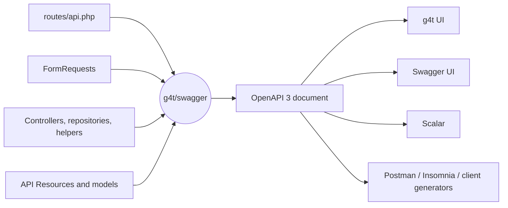

<p align="center">
  <picture>
    <source media="(prefers-color-scheme: dark)" srcset="art/logo-dark.svg">
    
  </picture>
</p>

<h3 align="center">API documentation that writes itself from your Laravel code.</h3>

<p align="center">
  Routes, FormRequests, controllers and API Resources become an <b>OpenAPI 3</b> document,<br>
  served with a documentation UI your team will actually use. No annotations to write or keep in sync.
</p>

<p align="center">
  <a href="https://packagist.org/packages/g4t/swagger"></a>
  <a href="https://packagist.org/packages/g4t/swagger"></a>
  <a href="https://github.com/hussein4alaa/laravel-g4t-swagger-auto-generate/actions/workflows/tests.yml"></a>
  
  
  
  <a href="LICENSE"></a>
</p>

<p align="center">
  <a href="https://swagger.g4t.io/"><b>Website</b></a> ·
  <a href="#-install-in-30-seconds">Install</a> ·
  <a href="#-what-is-read-from-your-code">What it reads</a> ·
  <a href="#%EF%B8%8F-the-documentation-ui">The UI</a> ·
  <a href="#%EF%B8%8F-settings-dashboard">Dashboard</a> ·
  <a href="#%EF%B8%8F-configuration-reference">Configuration</a> ·
  <a href="#-when-something-is-off">Troubleshooting</a>
</p>

<p align="center">
  
</p>

<p align="center">
  <picture>
    <source media="(prefers-color-scheme: dark)" srcset="art/screenshot-dark.png">
    
  </picture>
</p>

---

## ✨ Why g4t/swagger

| | |
|---|---|
| 🪄 **Nothing to annotate** | Routes, HTTP methods, middleware, path parameters and controller names become the document. Your code is the only source of truth, so the docs never drift. |
| 📝 **Request bodies from FormRequests** | Validation rules become typed schemas: enums, files, nested objects, `items.*.field` arrays, min / max and required fields. |
| 📦 **Responses from your code** | `response()->json([...])`, Resources, collections, paginators, `abort(404, '…')`, returned models, and even the repository or helper a controller calls. |
| 🧬 **Real schemas** | Resources and models become `$ref` components, so client generators (openapi-generator, orval, Kiota…) produce typed models. |
| 🧪 **Try it out, for real** | Typed forms, file uploads, environments with `{{variables}}`, several logins, local validation, error cases, history and code in five languages. |
| 🎛️ **A settings dashboard** | Change any option, drag endpoints into order, hide or deprecate them, write English / Arabic texts and create secret partner links, all from the browser. |
| 🔒 **Safe by default** | Off in production unless you enable it, optional Basic Auth, a cache file that is never public, and partner links stored only as hashes. |
| 🌍 **English and العربية** | Readers switch the language next to the title; Arabic text reads right to left. |



---

## 📚 Contents

- [Requirements](#-requirements)
- [Install in 30 seconds](#-install-in-30-seconds)
- [A five-minute tour](#-a-five-minute-tour)
- [Describing your API](#%EF%B8%8F-describing-your-api)
- [What is read from your code](#-what-is-read-from-your-code) · [Requests](#requests) · [Responses](#responses) · [Repositories and helpers](#repositories-and-helpers) · [Your own examples](#your-own-examples)
- [Extensions](#-extensions)
- [The documentation UI](#%EF%B8%8F-the-documentation-ui) · [Finding things](#finding-things) · [Trying requests](#trying-requests) · [Sharing and code](#sharing-and-code) · [Appearance](#appearance)
- [Logging in from the docs](#-logging-in-from-the-docs)
- [Security schemes, headers and environments](#%EF%B8%8F-security-schemes-headers-and-environments)
- [Webhooks](#-webhooks)
- [Flows](#-flows)
- [Settings dashboard](#%EF%B8%8F-settings-dashboard) · [Endpoints](#endpoints-order-visibility-texts-and-status) · [Partner links](#partner-links) · [Where settings are saved](#where-settings-are-saved)
- [Configuration reference](#%EF%B8%8F-configuration-reference)
- [Going to production](#-going-to-production)
- [Artisan commands](#%EF%B8%8F-artisan-commands)
- [When something is off](#-when-something-is-off)
- [Upgrading to 5.0](#%EF%B8%8F-upgrading-to-50)
- [Testing, contributing and license](#-testing-contributing-and-license)

---

## 🧰 Requirements

| Laravel | PHP |
|:---:|:---:|
| 13 | 8.3 – 8.5 |
| 12 | 8.2 – 8.5 |
| 11 | 8.2 – 8.4 |
| 10 | 8.1 – 8.3 |
| 9 | 8.0 – 8.2 |

Enum features (`Rule::enum()`, enum casts in response schemas) need PHP 8.1, like enums themselves.

---

## 🚀 Install in 30 seconds

```bash
composer require g4t/swagger
php artisan vendor:publish --tag=swagger-config
```

Open **`/swagger/documentation`**, for example `https://your-app.test/swagger/documentation`. That is it: every route in `routes/api.php` is already documented.

> [!NOTE]
> Only routes in the `api` middleware group are documented. Set `SWAGGER_INCLUDE_WEB_ROUTES=true` to include web routes that use your own controllers.

> [!TIP]
> The docs are **off in production** by default. Read [Going to production](#-going-to-production) before you deploy.

**Video walkthrough**

[](https://www.youtube.com/watch?v=bI1BY9tAwOw)

---

## 🧭 A five-minute tour

Write your API the way you already do:

```php
// routes/api.php
Route::apiResource('products', ProductController::class);
Route::post('auth/login', [AuthController::class, 'login'])->summary('Log in');
```

```php
// app/Http/Requests/StoreProductRequest.php
public function rules(): array
{
    return [
        'name' => ['required', 'string', 'max:255'],
        'price' => ['required', 'numeric', 'min:0'],
        'status' => ['required', Rule::enum(ProductStatus::class)],
        'tags' => ['nullable', 'array'],
        'tags.*' => ['string'],
        'image' => 'required|image|mimes:jpg,png|max:2048',
    ];
}
```

```php
// app/Http/Controllers/ProductController.php
public function store(StoreProductRequest $request): ProductResource
{
    return new ProductResource(Product::create($request->validated()));
}

public function show(Product $product): ProductResource
{
    abort_if($product->isArchived(), 404, 'Product not found.');

    return new ProductResource($product->load('category'));
}
```

Without a single annotation, the documentation now shows:

| Endpoint | What you get |
|---|---|
| `POST /api/products` | A multipart body with a typed `status` enum, a `tags` array and an `image` file field · a `201` response whose schema is `#/components/schemas/Product`, with `category` as a `$ref` to `Category` · a `422` validation example |
| `GET /api/products/{product}` | An integer path parameter · a `200` example · a `404` example with "Product not found." |
| `POST /api/auth/login` | The summary "Log in" from the route |

---

## 🏷️ Describing your API

Most text is derived for you. When you want more, add it to the route:

```php
Route::get('users', [UserController::class, 'index'])
    ->summary('List users')                                   // short title
    ->description('Paginated. Filter with `?search=`.');      // Markdown allowed

Route::get('internal/health', HealthController::class)->hiddenDoc();     // not in the public docs

Route::get('orders/{order}/invoice', [OrderController::class, 'invoice'])
    ->deprecated('2026-12-31', 'GET /api/v2/orders/{order}/invoice');    // removal date, replacement
Route::post('payments/split', [PaymentController::class, 'split'])->beta();
```

```php
use G4T\Swagger\Attributes\SwaggerSection;

#[SwaggerSection('Everything about your users')]   // description of the controller's section
class UserController extends Controller
{
}
```

Without `->summary()`, a readable summary comes from the action name:

| Action | Summary |
|---|---|
| `index` | List users |
| `store` | Create user |
| `show` | Get user |
| `update` | Update user |
| `destroy` | Delete user |
| `updateStatus` | Update status |

The dashboard can also [rewrite every summary and description](#endpoints-order-visibility-texts-and-status), in English and Arabic, without touching the code.

---

## 🔍 What is read from your code

### Requests

| Your code | In the document |
|---|---|
| FormRequest on a `POST` / `PUT` / `PATCH` action | Request body (`application/json` and `multipart/form-data`) |
| FormRequest on a `GET` / `DELETE` action | Query parameters |
| `required`, `nullable`, `sometimes`, `required_if` … | `required` list (conditional rules are not required) |
| `string`, `integer`, `numeric`, `boolean`, `array`, `date`, `email`, `uuid` | Types and formats |
| `min`, `max`, `size`, `between` | `minLength` / `maxLength` or `minimum` / `maximum` |
| `in:…`, `Rule::in()`, `Rule::enum()` | `enum` values |
| `file`, `image`, `mimes`, `mimetypes` | Binary fields (multipart only) |
| `address.city`, `items.*.id` | Nested objects and arrays of objects |
| `confirmed` | An extra `*_confirmation` field |
| `{id}`, `{id?}`, `whereNumber()`, bound model | Path parameters (optional ones become a second path) |
| `auth`, `auth:*`, `swagger.auth_middlewares` | `security` on the operation and a `401` response |

### Responses

| Your code | In the document |
|---|---|
| `response()->json([...])`, `new JsonResponse([...])` | Example with typed placeholders for variables |
| `new XResource(...)`, `XResource::make(...)` | `$ref` to the resource's component |
| `XResource::collection(...)` | Array of `$ref`; `paginate` / `simplePaginate` / `cursorPaginate` add `data` / `links` / `meta` |
| `return $model`, `Model::findOrFail()`, `Model::all()`, `: Model` return type | The model's component, typed from `$casts`, without `$hidden` |
| `abort(404, '…')`, `abort_if`, `abort_unless`, `throw new HttpException` | Error examples per status |
| `response()->json([...], 409)` | Error example (several per status become named examples) |
| `store` returning a resource, `json(..., 201)` | `201 Created`; `noContent()` gives `204` |
| `$this->whenLoaded('rel')`, `->load()`, `->with()` | Relations are included only when they are loaded |

### Repositories and helpers

A controller that hands the work to a repository or a response helper is followed into it, up to three calls deep, with the called method's parameters set from the arguments. Nothing is executed: the source is read.

```php
// Controller
public function store(CreateTicketRequest $request)
{
    return $this->ticketRepository->store($request);   // typed with an interface? the class bound in the container is used
}

// Repository
if (! $order) {
    return Helper::responseError('Order not found', code: Response::HTTP_NOT_FOUND);
}
return Helper::responseSuccess('Ticket created');

// Helper
public static function responseSuccess($message, $data = null)
{
    return response()->json(['status' => true, 'message' => $message, 'data' => $data], Response::HTTP_OK);
}
```

The document gets a `200` example `{"status": true, "message": "Ticket created", "data": null}` and a `404` example with "Order not found". Each method is read once per generation, so following calls costs a few milliseconds.

### Your own examples

Static analysis has limits. To force an example for a status, add a JSON file under `storage/swagger/{Controller}/{uri}/{status}.json`, where `{Controller}` is the controller name without "Controller" and `{uri}` is the route URI with `/`, `{`, `}` and `?` replaced by `-`.

For `GET /api/products/{product}` on `ProductController`, that is `storage/swagger/Product/-api-products--product-/200.json`:

```json
{
    "status_text": "The product",
    "response": { "id": 1, "name": "Linen shirt" }
}
```

---

## 🧩 Extensions

Teach the generator about code it cannot read on its own: Spatie Laravel Data, Laravel Actions, JSON:API, your own DTOs or response helpers. An extension is a class with up to four hooks; override only the ones you need.

Response wrappers need no extension. `return ApiResponse::success($user)`, a trait method like `$this->successResponse($data)` and your own helper functions like `api_success($data)` are followed, with the status they pass and the resource or model inside.

```bash
php artisan make:swagger-extension SpatieData   # app/Swagger/SpatieDataExtension.php
```

```php
use G4T\Swagger\Extensions\{Example, Extension, RequestSpec, ReturnedValue, RouteInfo};
use Spatie\LaravelData\Data;
use Illuminate\Support\Str;

class SpatieDataExtension extends Extension
{
    // public function store(UserData $data)  →  the JSON body
    public function request(RouteInfo $route): ?RequestSpec
    {
        $class = $route->parameterClass(Data::class);

        return $class ? RequestSpec::fromClass($class, fn ($name) => Str::snake($name)) : null;
    }

    // return UserData::from($user)  →  the example and a reusable UserData schema
    public function response(ReturnedValue $value): ?Example
    {
        return $value->isStaticCallOn(Data::class, 'from')
            ? Example::fromClass($value->staticCall()['class'], fn ($name) => Str::snake($name))
            : null;
    }
}
```

Register it in `config/swagger.php`, or from a package's service provider:

```php
"extensions" => [App\Swagger\SpatieDataExtension::class],
```

```php
\G4T\Swagger\Swagger::extend(SpatieDataExtension::class);   // in boot()
```

| Hook | Called with | Returns |
|---|---|---|
| `request(RouteInfo $route)` | Every documented route, before the FormRequest rules are read | A `RequestSpec`, or `null` to let the next extension (then the FormRequest) decide |
| `response(ReturnedValue $value)` | Every returned expression, and values nested in a `json([...])` payload, in controllers and the repositories / helpers they call | An `Example`, or `null` |
| `operation(array $operation, RouteInfo $route)` | Every OpenAPI operation, once built | The operation, changed or not (content types, extra responses, headers…) |
| `document(array $document)` | The whole document, at the end | The document |

**Building blocks**

| | |
|---|---|
| `RequestSpec::fromRules($rules)` | Laravel rules, read exactly like a FormRequest: types, enums, files, nested fields |
| `RequestSpec::fromClass($class, $key)` | A JSON body from a class's public typed properties; `$key` maps names (e.g. snake case) |
| `RequestSpec::fromSchema($schema)` | An OpenAPI schema, as is |
| `->asQuery()` | The rules describe query parameters, even on POST |
| `Example::of($value, $component)` | A literal example; with a component name it becomes a `$ref` schema |
| `Example::fromClass($class, $key)` / `Example::listOf(...)` | An example from typed properties; the class and nested classes become components |
| `$example->wrap(fn ($v) => ['data' => $v])` | An envelope around it |
| `RouteInfo` | `route`, `method`, `uri`, `controller`, `action`, `operationId`, `tag`, `reflection()`, `parameterClass($class)`, `hasMiddleware($name)` |
| `ReturnedValue` | `source`, `class`, `method`, `staticCall()`, `newObject()`, `isStaticCallOn($class, $method)`, `resolveClass($name)` |

`fromClass()` types `array` and collection properties from a `@var list<X>` / `X[]` doc comment (or `@param` on a promoted constructor parameter), and reads enums and dates.

> [!NOTE]
> Nothing is executed and an extension cannot break the docs: an exception in a hook is logged (with `APP_DEBUG`) and ignored. Without extensions there is no extra cost.

---

## 🖥️ The documentation UI

Three interfaces ship with the package. Pick one with `ui`, or with `?ui=` on the URL for one visit:

| `ui` | Interface |
|---|---|
| **`g4t`** (default) | The package's own reference UI, bundled, nothing loaded from a CDN |
| `swagger` | Swagger UI, bundled, with a theme picker |
| `scalar` | [Scalar API Reference](https://github.com/scalar/scalar), loaded from jsDelivr at a pinned version |

Everything below is in the `g4t` UI.

### Finding things

| Feature | What it does |
|---|---|
| 🔎 **Search everything** | The filter (<kbd>/</kbd>) matches paths and summaries, and also request and response fields, descriptions and examples: type `phone` to find every endpoint that sends or returns it. |
| ⌨️ **Command palette** | <kbd>⌘K</kbd> / <kbd>Ctrl+K</kbd> jumps to any endpoint, field or section, or runs an action: log in, switch environment, export, change mode or language, open the models diagram. |
| 🧷 **Where is this field used** | Click a field name in any table to list every endpoint that has it, and where (query, request or response). |
| 🕸️ **Models diagram** | The response models and the `$ref` links between them; click one to see what it links to and the endpoints that use it. |
| 🧭 **Getting started** | A card above the endpoints with the base URL, how to authenticate, the headers to send, the shape of 401 / 403 / 404 / 422 errors, pagination and deprecations, all worked out from the document. |
| 🗂️ **Navigation** | One section per controller, a version switcher, deep links (`#op-<operationId>`), and a drawer on phones. |

### Trying requests

| Feature | What it does |
|---|---|
| 🧪 **Try it out** | A typed form (selects for enums and booleans, date and file pickers, one row per array item) or a JSON editor, with real requests, status, timing and highlighted responses. |
| ✅ **Checked before sending** | Values are compared with the documented rules (required, types, lengths, enums, emails) and the problems are listed; **Send anyway** sends them as they are. |
| 💥 **Error cases** | One click sends invalid requests on purpose: no credentials, an unknown id, a missing, too long or invalid field. A table shows which got the expected 401 / 404 / 422. |
| 🌐 **Environments** | Base URL, headers and `{{variables}}` usable in any parameter, field, header or body; `{{token}}` is the current bearer token. |
| 🕘 **Memory and history** | Inputs survive reloads (Reset per endpoint); the last 10 requests per endpoint can be restored or re-run. |
| ⏱️ **Response times** | Each endpoint shows the average time of your last requests, and a card lists the slowest first. Kept in your browser only. |
| 📄 **Responses** | Status-code tabs, named examples, and an Example / Schema switch. |

### Sharing and code

| Feature | What it does |
|---|---|
| 💻 **Code samples** | cURL, JavaScript (`fetch`), Dart (`Dio`) and PHP (Laravel `Http`) for every request. |
| 📱 **Flutter** | Request and response model classes with `fromJson` / `toJson`, and a repository method using Dio, ready to paste into an app. |
| 🔗 **Share links and QR codes** | A link that opens Try it out with the same values, for a teammate to press Execute, plus a QR code to open it on a phone. Credentials, and values whose name looks like one (`password`, `token`, `api_key`…), are never put in it. |
| 📤 **Export** | The OpenAPI document as JSON or YAML, a Postman collection (a folder per section, path variables, `{{baseUrl}}` and `{{token}}`) and environment, or an Insomnia export with every environment. |
| 🎤 **Present mode** | One endpoint full screen in large type; <kbd>←</kbd> / <kbd>→</kbd> moves through them, for walking a team through the API. |
| 🌍 **English / العربية** | Texts written in the dashboard in both languages; readers switch next to the title. |

### Appearance

Light (default), dark or system mode, comfortable or compact density, and accent colors.

```php
// config/swagger.php
"ui" => env("SWAGGER_UI", "g4t"),        // g4t | swagger | scalar
"g4t" => [
    "mode" => "light",                   // light | dark | system
    "density" => "comfortable",          // comfortable | compact
    "getting_started" => true,           // the Getting started card
],
"theme" => env("SWAGGER_THEME", "default"), // Swagger UI theme / g4t accent
"scalar" => [
    "version" => "1.73.0",
    "theme" => "purple",                 // default, moon, purple, solarized, bluePlanet, deepSpace, saturn, kepler, mars, laserwave, ...
    "layout" => "modern",                // modern | classic
    "dark_mode" => null,                 // null lets the reader toggle
    "locale" => null,                    // e.g. "ar"
    "direction" => "auto",               // auto | ltr | rtl
],
```

The Swagger UI files are published with the package assets (`php artisan vendor:publish --tag=swagger-assets`). Each entry of `versions` becomes a definition in Swagger UI and a source in Scalar.

---

## 🔑 Logging in from the docs

Point `auto_login` at your login endpoint and a **Log in** button appears in every interface. It posts the credentials as JSON, reads the token from the response, and sends it as `Authorization: Bearer …` with every protected operation. Readers can also paste a token by hand (**Authorize**), and the token is shared between the three UIs until **Log out**.

```php
"auto_login" => [
    "url" => env("SWAGGER_LOGIN_URL"),   // e.g. "/api/auth/login"; null hides the login form
    "method" => "POST",
    "fields" => ["email" => "Email", "password" => "Password"],
    "token_path" => env("SWAGGER_LOGIN_TOKEN_PATH"), // dot path; token, access_token, data.token… are tried when empty
    "security_scheme" => "bearerAuth",   // key in security_schemes
    "prefill" => [],                     // pre-filled values, only rendered in the local environment
],
```

**Several logins.** A customer API and an admin API? Make `auto_login` a list. The g4t Log in dialog lets the reader pick one, and each fills its own `security_scheme`, so a reader can be signed in to all of them at once. Swagger UI and Scalar use the first one.

```php
"auto_login" => [
    ["name" => "Customer", "url" => "/api/v1/auth/login", "security_scheme" => "bearerAuth"],
    ["name" => "Admin", "url" => "/api/admin/login", "fields" => ["username" => "Username", "password" => "Password"], "security_scheme" => "adminAuth"],
],
```

---

## 🛡️ Security schemes, headers and environments

Every scheme in `security_schemes` is documented and works in Try it out: Authorize shows one field per scheme, and each request carries the credential where its scheme expects it. Protected routes accept any one of the schemes.

```php
"security_schemes" => [
    "bearerAuth" => ["type" => "http", "scheme" => "bearer"],                      // Authorization: Bearer …
    "apiKey"     => ["type" => "apiKey", "in" => "header", "name" => "X-API-Key"], // X-API-Key: …
    "queryKey"   => ["type" => "apiKey", "in" => "query", "name" => "api_key"],    // ?api_key=…
    "basicAuth"  => ["type" => "http", "scheme" => "basic"],                       // Authorization: Basic …
],
```

API keys in a cookie are documented, but a browser page cannot set them; use the code samples for those.

**A header on every request** (a language, a tenant, a request id…) goes in `global_headers`; every UI then shows an input for it:

```php
"global_headers" => [
    ["name" => "Accept-Language", "description" => "Response language", "enum" => ["en", "ar"], "default" => "en"],
    ["name" => "X-Tenant", "required" => true, "example" => "acme"],
    "X-Request-Id",
],
```

**Shared environments** switch the base URL, the `{{variables}}` readers type in any field, and headers sent with every request. Readers can create their own; the ones in `environments` are shared with everyone and read-only for readers, who can duplicate them to change values.

```php
"environments" => [
    [
        "name" => "Staging",
        "base_url" => "https://staging.example.com",
        "variables" => ["tenant" => "acme"],
        "headers" => ["X-Tenant" => "{{tenant}}"],
    ],
],
```

> [!WARNING]
> Shared environments are visible in the page. Never put secrets in them.

---

## 🪝 Webhooks

Document the webhooks your API **sends** to your clients. Each gets a page under **Webhooks** in the g4t UI with its headers, its payload (schema and example), **Copy as cURL**, and **Send test webhook**: the reader types the URL of their own app and the payload goes there from their browser. Nothing is ever sent from your server.

```php
"webhooks" => [
    [
        "name" => "order.status_changed",
        "summary" => "An order changed status",
        "description" => "Sent when an order is paid, shipped or cancelled.",
        "method" => "POST",                     // POST (default), PUT or PATCH
        "headers" => [
            ["name" => "X-Signature", "description" => "HMAC-SHA256 of the body with your secret", "example" => "sha256=5d41402a"],
        ],
        "class" => App\Http\Resources\OrderResource::class,
    ],
    [
        "name" => "invoice.paid",
        "example" => ["event" => "invoice.paid", "data" => ["id" => 1, "total" => 25000]],
    ],
],
```

| Payload | How it is read |
|---|---|
| `"example" => [...]` | As is; the schema is worked out from it |
| `"class" => XResource::class` | The resource's `toArray()`, like a controller response |
| `"class" => Order::class` | The model's row, typed from `$casts`, without `$hidden` |
| `"class" => OrderData::class` | A DTO's public typed properties (promoted constructor parameters included) |

An `example` next to a `class` replaces the generated example. OpenAPI 3.0.3 has no `webhooks`, so they travel as `x-webhooks` in the document, in the shape of 3.1's `webhooks`.

- **Test sends and CORS:** when the reader's server does not allow the docs page through CORS, the webhook goes as plain text instead, without the custom headers, and the page says that the response could not be read. Copy as cURL always works.
- **Hide** a webhook like an endpoint: `"hidden" => true` in the config, or the eye on the dashboard's **Webhooks** page. Partner links can still pick it.
- The dashboard edits the list too (payload as a JSON example). Once saved there, the dashboard's list replaces the config file's; webhooks with a `class` keep it.

---

## 🔗 Flows

A flow runs several documented requests one after another in one click: log in, create an order, pay it. Build them on the dashboard's **Flows** page: pick each step's endpoint from a searchable list, reorder the steps, and fill in its path and query values, headers and JSON body.

- **Variables:** any value may use `{{name}}`, like everywhere in Try it out. A step can **keep** values from its response for the next steps: `body.data.token`, `body.data.0.id`, `headers.x-request-id` or `status`. A numeric variable can go unquoted in a body: `{"order_id": {{order_id}}}`.
- Step headers come after the reader's own credentials, so `Authorization: Bearer {{token}}` replaces them.
- In the g4t UI, **Run flow** sends the steps through the same code as Try it out (the reader's environment, server and credentials), shows each step's request, status and response, stops at the first failure (a 4xx / 5xx, or a value to keep that is not in the response), and lists the variables it set.
- A flow only shows where every endpoint it uses does: not in a version without them, not in the public docs when a step is hidden.
- **Hide** a flow with the eye, like an endpoint; partner links can still pick it.
- Flows travel as `x-flows` in the document.

---

## 🎛️ Settings dashboard

Everything in this README can also be changed from a dashboard, without editing `config/swagger.php`. It is off until it has credentials:

```dotenv
SWAGGER_DASHBOARD_USERNAME=admin
SWAGGER_DASHBOARD_PASSWORD=a-long-random-password   # or a bcrypt/argon hash from Hash::make()
```

Then open **`/swagger/dashboard`** (`SWAGGER_DASHBOARD_URL`). Sign-in uses the session (the `web` middleware group) and allows 5 attempts a minute per IP.

| Section | What you change |
|---|---|
| General | Title, version, contact, description, and the Arabic title and description |
| Interface | g4t / Swagger UI / Scalar, mode, density, accent, the Getting started card |
| Endpoints | Order, visibility, texts, status and notes ([below](#endpoints-order-visibility-texts-and-status)) |
| Versions and servers | Version filters (`v1`, or path segments like `driver/v1`) and servers |
| Security schemes | Bearer, basic, API keys, and the middleware that marks a route as protected |
| Global headers | Headers documented on every operation |
| Environments | Shared environments with variables and headers |
| Webhooks | Webhooks your API sends, their headers and payload ([above](#-webhooks)) |
| Try it out logins | One or several logins, each with its fields and scheme |
| Flows | Chained requests run in one click ([above](#-flows)) |
| Generation | Response examples, error examples, schemas, web routes, prefixes, Spatie Query Builder |
| Access | Docs on or off, Basic Auth and its credentials |
| Partner links | Secret links for partners ([below](#partner-links)) |

### Endpoints: order, visibility, texts and status

- **Drag** sections and endpoints to set their order in every UI.
- **Hide** an endpoint, or a whole controller with the eye next to its name (endpoints added to it later stay hidden too). The routes keep working.
- **Texts:** the pen button edits the summary and description in English (replacing the text from your code) and in Arabic.
- **Status:** New, Beta, or Deprecated with a removal date and a replacement, plus a **note for clients**. The g4t UI shows a badge, a notice with the days left, and a Deprecations list in Getting started; Swagger UI and Scalar strike it through (`deprecated: true`) and show the same text in the description. A status set in code with `->deprecated()` or `->beta()` is replaced by the dashboard; choose **Stable** to clear it.

### Partner links

A secret address per partner or client, for when you want someone to see part of your API and nothing else.

- Opens the g4t UI **without the docs password**, even when the docs are turned off with `SWAGGER_ENABLED=false`.
- Shows only what you pick: whole sections, single endpoints found with a search, or both, and only the schemas they use.
- A single endpoint is shown even when it is hidden from the public docs (with the dashboard eye or `->hiddenDoc()`), so you can share an internal endpoint with one client only.
- Versions, shared environments and security schemes: **Default** (all of them), or only the ones you pick. Environments can also be **None**, which keeps their base URLs and values private.
  - A link limited to some versions never opens another one, even with `?version=` in the address.
  - With picked schemes, protected endpoints ask for those schemes, and only their Try it out logins are shown.
- **Webhooks** and **flows** work like single endpoints: **Default** shows the visible ones, **Pick** the ones you choose (hidden ones included), **None** nothing. A flow also needs every one of its steps inside the link; the dashboard marks picked flows that have steps outside it.
- **Branding:** an accent color (`#RRGGBB`, lightened in dark mode when needed), a logo shown instead of the g4t logo (`https://…` or a path on your site), and a welcome message in English and Arabic shown above the endpoints, with its line breaks. All optional.
- Can expire on a date. Removing the link revokes it.
- The address always shows in the dashboard. **New address** makes another one, and the old one stops working when you save, for example when it leaked.
- Requests are matched on a sha256 of the token. The token itself is kept encrypted with your `APP_KEY` so the dashboard can show it. If the key changes, the links still work but their addresses can't be shown, so make new ones.

> [!NOTE]
> Middleware you add in `swagger.middleware` still applies to partner links.

### Where settings are saved

Saved changes go to `swagger-settings.json` in the project root (`SWAGGER_DASHBOARD_SETTINGS_PATH`, relative to the root or absolute), outside `public/`, so it is never served.

- Only the values you changed are kept; everything else keeps following `config/swagger.php`. Saving the config file's value again removes the override.
- **Reset** removes every dashboard change, including partner links.
- Saving also clears the `swagger:cache` file.
- Commit the file to ship the same settings to every server. It holds the docs password if you set one in the dashboard.
- Settings saved by earlier versions in `storage/app/swagger/settings.json` keep working and move to the new file on the next save.
- Turn the dashboard off with `SWAGGER_DASHBOARD_ENABLED=false`.

#### Several servers, Kubernetes or autoscaling

A local file only lives on one server, and a pod loses it when it restarts. Keep the settings on a shared [filesystem disk](https://laravel.com/docs/filesystem) instead, such as `s3`, so every server reads the same settings and dashboard changes need no deploy:

```env
SWAGGER_DASHBOARD_SETTINGS_DISK=s3
```

Or choose the disk on the dashboard's **Storage** page. It copies the saved settings to the disk, checks that they read back, and leaves a small local `swagger-settings.json` that only says which disk to read. Commit that file (or set the variable above) so new servers find the disk too. A disk set in `.env` or the config file can't be changed from the dashboard.

- The settings are read on every request, so a disk is read through the cache for `SWAGGER_DASHBOARD_SETTINGS_CACHE_TTL` seconds (60 by default; `0` reads the disk each time). A save updates the cache at once. With a shared store (Redis, database) every server sees the change immediately; with a local one, within that time. `SWAGGER_DASHBOARD_SETTINGS_CACHE_STORE` picks the store.
- `SWAGGER_DASHBOARD_SETTINGS_PATH` is then the file's path on the disk.
- A disk that can't be reached never breaks your app: the config file applies until it's back.
- S3 needs Laravel's adapter: `composer require league/flysystem-aws-s3-v3 "^3.0"`.

---

## ⚙️ Configuration reference

All keys live in `config/swagger.php`.

| Key | Env | Default | |
|---|---|---|---|
| `enable` | `SWAGGER_ENABLED` | `true` except in production | Turns the docs routes on or off |
| `url` | `SWAGGER_URL` | `swagger/documentation` | Docs URL; the JSON is at `{url}/json` |
| `title` / `description` / `version` | `SWAGGER_TITLE` … | | `info` block of the document |
| `servers` | | `APP_URL` | Servers listed in the document |
| `versions` / `default` | | `["all"]` / `all` | Version filter: `v1` matches `/api/v1/…`, `driver/v1` matches `/api/driver/v1/…` |
| `show_prefix` | | `[]` | Only document routes with these prefixes |
| `include_web_routes` | `SWAGGER_INCLUDE_WEB_ROUTES` | `false` | Also document web routes using your controllers |
| `auth_middlewares` | | `auth`, `auth:api`, `auth:sanctum` | Middleware names that mark a route as protected |
| `security_schemes` | | HTTP bearer | Bearer, basic, API key in a header or query |
| `global_headers` | | `[]` | Header parameters added to every operation |
| `environments` | | `[]` | Shared environments for the g4t UI |
| `webhooks` | | `[]` | [Webhooks](#-webhooks) your API sends, documented as `x-webhooks` |
| `auto_login` | `SWAGGER_LOGIN_URL`, `SWAGGER_LOGIN_TOKEN_PATH` | off | One login or a list of logins |
| `infer_response_examples` | | `true` | Success examples from controllers |
| `infer_error_response_examples` | | `true` | Error examples (`abort`, `json(…, 4xx)`, `422`) |
| `response_schemas` | `SWAGGER_RESPONSE_SCHEMAS` | `true` | Response schemas and `$ref` components |
| `unwrap_resource_collection_examples` | | `true` | Non-paginated collections as a top-level array |
| `spatie_query_builder` | | `false` | Adds `filter`, `sort` and `include` to GET routes |
| `extensions` | | `[]` | [Extension](#-extensions) classes |
| `ui` / `g4t` / `theme` / `scalar` | `SWAGGER_UI`, `SWAGGER_THEME` | `g4t` | The [interface and its look](#appearance) |
| `enable_auth` | `SWAGGER_AUTH_ENABLED` | `false` | Basic Auth on the docs (`SWAGGER_USERNAME`, `SWAGGER_PASSWORD`) |
| `session_ttl` | `SWAGGER_SESSION_TTL` | `100000` | Basic Auth idle timeout in seconds, when the docs run with a session |
| `middleware` | | `[]` | Extra middleware for the docs routes, e.g. `["web", "auth"]` |
| `use_cached_spec_when_present` | `SWAGGER_USE_CACHED_SPEC` | `true` | Serve the `swagger:cache` file when it exists |
| `cached_spec_location` | `SWAGGER_CACHED_SPEC_LOCATION` | `storage` | Where `swagger:cache` writes (`storage` or `public`) |
| `dashboard` | `SWAGGER_DASHBOARD_*` | off until credentials are set | `enabled`, `url`, `username`, `password`, `settings_path`, `settings_disk`, `settings_cache_ttl`, `settings_cache_store`, `middleware` |

---

## 🌐 Going to production

A short checklist for a public or staging server:

1. **Turn the docs on** where you want them: `SWAGGER_ENABLED=true`.
2. **Protect them**, with Basic Auth or your own guards:
   ```dotenv
   SWAGGER_AUTH_ENABLED=true
   SWAGGER_USERNAME=docs
   SWAGGER_PASSWORD=a-long-random-password   # an empty password never authenticates
   ```
   or `"middleware" => ["web", "auth"]` in `config/swagger.php`.
3. **Cache the document** during deployment, so it is not generated on every request:
   ```bash
   php artisan swagger:cache
   ```
   The file is stored outside `public/` and only served through the docs JSON endpoint, so Basic Auth and your middleware still apply.
4. **Share with partners** through [partner links](#partner-links) instead of handing out the docs password.
5. **Decide about the dashboard:** keep it behind strong credentials, or turn it off with `SWAGGER_DASHBOARD_ENABLED=false` and ship `swagger-settings.json` with the code.

---

## 🛠️ Artisan commands

| Command | What it does |
|---|---|
| `swagger:cache` | Writes the OpenAPI document to the cache file; `--clear` removes it |
| `make:swagger` | Older alias of `swagger:cache` |
| `make:swagger-extension {name}` | Creates an [extension](#-extensions) class in `app/Swagger` |
| `swagger:mock-server` | Uploads your document to the G4T mock server (experimental) |

<details>
<summary><b>Mock server (experimental)</b></summary>

G4T provides an **optional** command that connects your generated documentation to a **hosted mock API** run by G4T, so you can explore or demo your API while you build it, without hosting that side yourself.

```bash
php artisan swagger:mock-server
```

Set `MOCK_SERVER_APP_ID` to always update the same mock app without prompts.

> [!CAUTION]
> This feature is under testing. It may change, pause or evolve without much notice. Do not rely on it for business-critical paths yet.

</details>

---

## 🩺 When something is off

<details>
<summary><b>A route is missing from the docs</b></summary>

- It must be in the `api` middleware group (or set `SWAGGER_INCLUDE_WEB_ROUTES=true` for web routes that use your controllers).
- `show_prefix` limits the docs to some prefixes, and the version selector shows one version at a time; pick **all**.
- It may be hidden with `->hiddenDoc()` or with the eye in the dashboard.
- A cached document is served while the cache file exists: run `php artisan swagger:cache` again, or `--clear`.

</details>

<details>
<summary><b>The docs answer 403 in production</b></summary>

They are off in production by default. Set `SWAGGER_ENABLED=true`, and protect them as described in [Going to production](#-going-to-production).

</details>

<details>
<summary><b>An example is missing or wrong</b></summary>

Examples come from reading the source, so very dynamic code (a response built through many conditions, a class picked at runtime) cannot always be followed. Force the example with a [JSON file](#your-own-examples), or turn inference off with `infer_response_examples` / `infer_error_response_examples`.

</details>

<details>
<summary><b>My changes do not show up</b></summary>

- A `swagger:cache` file is being served: rebuild it or run `php artisan swagger:cache --clear`.
- A value saved in the dashboard overrides `config/swagger.php`; the dashboard marks those sections "saved in dashboard". Save the config value there again, or use **Reset**.
- Run `php artisan config:clear` after changing `.env` if the config is cached.

</details>

<details>
<summary><b>Try it out says "Network error"</b></summary>

The request did not reach the server: the selected server URL is not reachable from the browser, or another origin blocks it with CORS. Pick the server marked "This page" in the server selector, or set `servers` (or `APP_URL`) to the address the docs run on.

</details>

<details>
<summary><b>Log in works but "no token was found"</b></summary>

Set `token_path` (`SWAGGER_LOGIN_TOKEN_PATH`) to where your login response keeps the token, e.g. `data.token` or `data.access_token`.

</details>

<details>
<summary><b>Swagger UI loads without styles or scripts</b></summary>

Publish the assets: `php artisan vendor:publish --tag=swagger-assets`.

</details>

---

## ⬆️ Upgrading to 5.0

- **The `g4t` UI is the new default.** Set `SWAGGER_UI=swagger` to keep Swagger UI.
- **Off in production by default.** `enable` now defaults to `APP_ENV !== production`; set `SWAGGER_ENABLED=true` to keep the docs online there.
- **The cached spec moved out of `public/`.** `swagger:cache` / `make:swagger` write to `storage/app/swagger/{cached_spec_path}`. Set `SWAGGER_CACHED_SPEC_LOCATION=public` for the old location, and remove any old `public/doc.json` (`php artisan swagger:cache --clear` removes both).
- **Basic Auth** reads `SWAGGER_AUTH_ENABLED`, `SWAGGER_USERNAME` and `SWAGGER_PASSWORD`; an empty password never authenticates. `session_ttl` replaces the misspelled `sesson_ttl` (still read).
- **Valid OpenAPI 3.0.** `paths` and `tags` are at the document root, nested rules become nested schemas, optional path parameters produce one path per variant, and `auth:sanctum` routes are detected.
- **Status codes.** `store` actions returning a resource are documented as `201`, `noContent()` as `204`.
- **Security scheme.** The default scheme is HTTP bearer (`bearerAuth`): paste just the token, without `Bearer `.
- **Same-name controllers** in different namespaces get distinct sections and schemas (`V1/Product`, `V2/Product`).

---

## 🤝 Testing, contributing and license

```bash
composer test
```

The suite runs on Orchestra Testbench, and GitHub Actions covers every supported pair above (Laravel 9 to 13, PHP 8.0 to 8.5), including the lowest supported dependencies.

- **Ideas:** the [Canny board](https://g4t.canny.io/).
- **Issues and pull requests:** welcome on [GitHub](https://github.com/hussein4alaa/laravel-g4t-swagger-auto-generate); see [CONTRIBUTING.md](CONTRIBUTING.md).
- **Security:** report vulnerabilities as described in [SECURITY.md](SECURITY.md).
- **License:** open source under the [MIT license](LICENSE).
- **Maintainer:** [Hussein Alaa](https://www.linkedin.com/in/hussein4alaa/).

**More reading:** [website](https://swagger.g4t.io/) · [OpenAPI specification](https://swagger.io/specification/) · [Laravel documentation](https://laravel.com/docs)

<p align="center">
  
</p>
