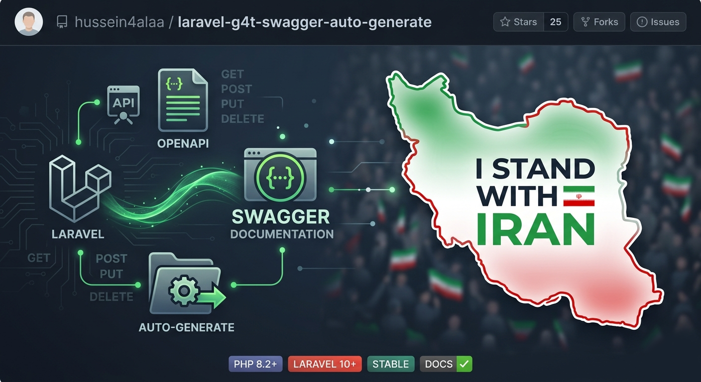
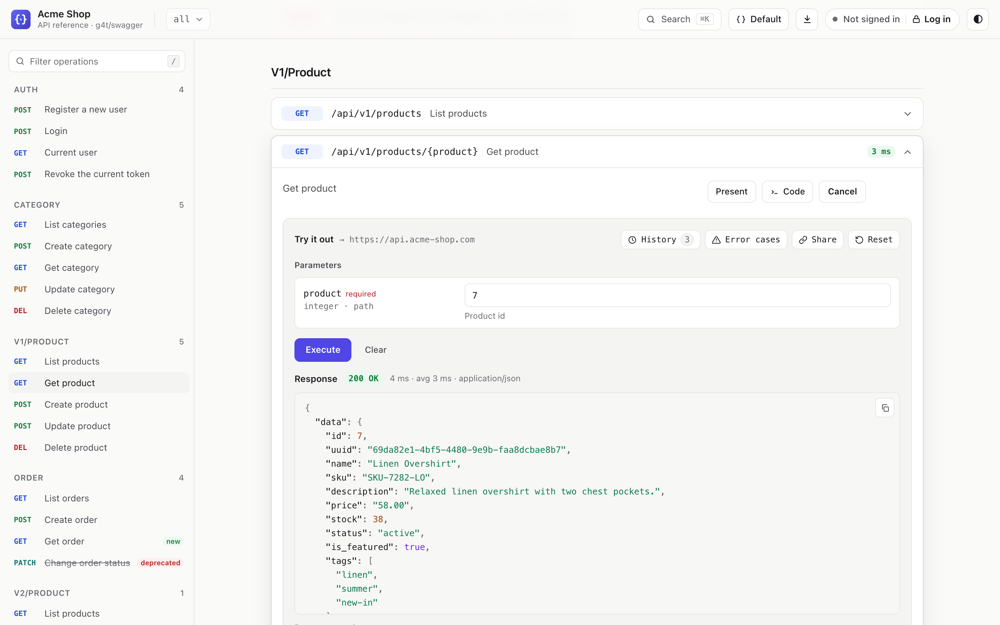
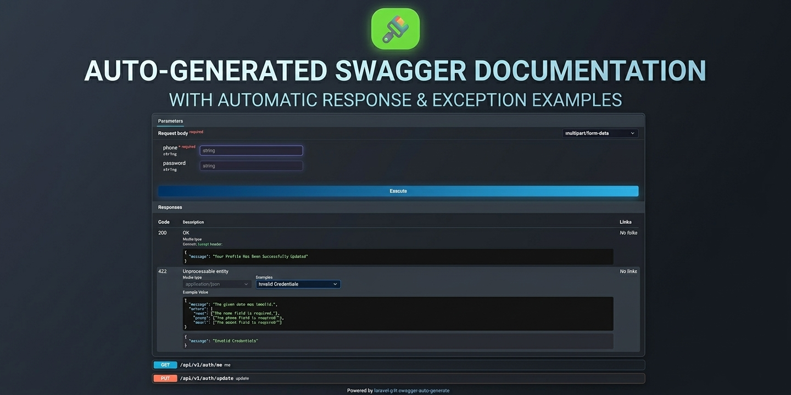

<p align="center">
  <picture>
    <source media="(prefers-color-scheme: dark)" srcset="art/logo-dark.svg">
    
  </picture>
</p>

<p align="center">
  <b>Automatic OpenAPI documentation for Laravel.</b><br>
  Built from your routes, FormRequests, controllers and API Resources. No annotations to write or keep in sync.
</p>

<p align="center">
  <a href="https://packagist.org/packages/g4t/swagger"></a>
  <a href="https://packagist.org/packages/g4t/swagger"></a>
  <a href="https://github.com/hussein4alaa/laravel-g4t-swagger-auto-generate/actions/workflows/tests.yml"></a>
  
  
  <a href="LICENSE"></a>
</p>

<p align="center">
  
</p>

<p align="center">
  <a href="https://swagger.g4t.io/"><b>Documentation</b></a> ·
  <a href="#installation">Installation</a> ·
  <a href="#the-documentation-ui">The UI</a> ·
  <a href="#settings-dashboard">Dashboard</a> ·
  <a href="#configuration">Configuration</a> ·
  <a href="#upgrading-to-50">Upgrading to 5.0</a>
</p>

<p align="center">
  
</p>

## Why g4t/swagger

- **Nothing to annotate.** Routes, HTTP methods, middleware, path parameters and controller names become the OpenAPI document.
- **Request bodies from your FormRequests.** Validation rules become typed schemas: enums, files, nested objects, `items.*.field` arrays, min/max and required fields.
- **Response examples from your code.** `response()->json([...])`, `new XResource(...)`, `XResource::collection(...)`, paginators, `abort(404, '…')`, returned models and more, typed from your model casts.
- **Real response schemas.** Resources and models become `$ref` components, so client generators (openapi-generator, orval, Kiota…) produce typed models.
- **A documentation UI people enjoy using.** Try it out with file uploads, code samples (cURL, JavaScript, Dart, PHP), environments with `{{variables}}`, request history, light/dark mode, and nothing loaded from a CDN. Swagger UI and Scalar are included too.
- **A settings dashboard.** Change the config, drag operations into order and hide endpoints from the browser, behind its own sign-in.
- **Safe by default.** Docs are off in production unless you turn them on; optional Basic Auth; the cached spec is never public.

## Requirements

| Laravel | PHP |
|---|---|
| 13 | 8.3 – 8.5 |
| 12 | 8.2 – 8.5 |
| 11 | 8.2 – 8.4 |
| 10 | 8.1 – 8.3 |
| 9 | 8.0 – 8.2 |

Enum features (`Rule::enum()`, enum casts in response schemas) need PHP 8.1, like enums themselves.

## Installation

```bash
composer require g4t/swagger
```

Publish the configuration file:

```bash
php artisan vendor:publish --tag=swagger-config
```

Then open **`/swagger/documentation`** in your browser, e.g. `https://your-app.test/swagger/documentation`.

> Only routes with the `api` middleware group are documented (everything in `routes/api.php`). Set `SWAGGER_INCLUDE_WEB_ROUTES=true` to include web routes that use your own controllers.

#### Video walkthrough

[](https://www.youtube.com/watch?v=bI1BY9tAwOw)

## Quick start

Write your API as usual:

```php
// routes/api.php
Route::apiResource('products', ProductController::class);
Route::post('auth/login', [AuthController::class, 'login'])->summary('Log in');
```

```php
// app/Http/Requests/StoreProductRequest.php
public function rules(): array
{
    return [
        'name' => ['required', 'string', 'max:255'],
        'price' => ['required', 'numeric', 'min:0'],
        'status' => ['required', Rule::enum(ProductStatus::class)],
        'tags' => ['nullable', 'array'],
        'tags.*' => ['string'],
        'image' => 'required|image|mimes:jpg,png|max:2048',
    ];
}
```

```php
// app/Http/Controllers/ProductController.php
public function store(StoreProductRequest $request): ProductResource
{
    return new ProductResource(Product::create($request->validated()));
}

public function show(Product $product): ProductResource
{
    abort_if($product->isArchived(), 404, 'Product not found.');

    return new ProductResource($product->load('category'));
}
```

The documentation now shows, for `POST /api/products`, a multipart body with a typed `status` enum, a `tags` array and an `image` file field; a `201` response whose schema is `#/components/schemas/Product` (with its `category` relation as a `$ref` to `Category`); and a `422` validation example. `GET /api/products/{product}` gets an integer path parameter, a `200` example and a `404` "Product not found." example.

## Describing your API

```php
Route::get('users', [UserController::class, 'index'])
    ->summary('List users')                                   // short title
    ->description('Paginated. Filter with `?search=`.');      // Markdown allowed

Route::get('internal/health', HealthController::class)->hiddenDoc(); // not documented
```

```php
use G4T\Swagger\Attributes\SwaggerSection;

#[SwaggerSection('Everything about your users')]   // description of the controller's tag
class UserController extends Controller
{
}
```

Without `->summary()`, a readable summary is derived from the action: `index` → "List users", `store` → "Create user", `show` → "Get user", `update` → "Update user", `destroy` → "Delete user", `updateStatus` → "Update status".

## What is inferred

### Requests

| Your code | In the document |
|---|---|
| FormRequest type-hinted on a `POST` / `PUT` / `PATCH` action | Request body (`application/json` and `multipart/form-data`) |
| FormRequest on a `GET` / `DELETE` action | Query parameters |
| `required`, `nullable`, `sometimes`, `required_if` … | `required` list (conditional rules are not required) |
| `string`, `integer`, `numeric`, `boolean`, `array`, `date`, `email`, `uuid` | Types and formats |
| `min`, `max`, `size`, `between` | `minLength` / `maxLength` or `minimum` / `maximum` |
| `in:…`, `Rule::in()`, `Rule::enum()` | `enum` values |
| `file`, `image`, `mimes`, `mimetypes` | Binary fields (multipart only) |
| `address.city`, `items.*.id` | Nested objects and arrays of objects |
| `confirmed` | An extra `*_confirmation` field |
| `{id}`, `{id?}`, `whereNumber()`, bound model | Path parameters (optional ones become a second path) |
| `auth`, `auth:*`, `swagger.auth_middlewares` | `security` on the operation and a `401` response |

### Responses

| Your code | In the document |
|---|---|
| `response()->json([...])`, `new JsonResponse([...])` | Example with typed placeholders for variables |
| `new XResource(...)`, `XResource::make(...)` | `$ref` to the resource's component |
| `XResource::collection(...)` | Array of `$ref`; `paginate` / `simplePaginate` / `cursorPaginate` add `data` / `links` / `meta` |
| `return $model`, `Model::findOrFail()`, `Model::all()`, `: Model` return type | The model's component, typed from `$casts`, without `$hidden` |
| `abort(404, '…')`, `abort_if`, `abort_unless`, `throw new HttpException` | Error examples per status |
| `response()->json([...], 409)` | Error example (several per status become named examples) |
| `store` returning a resource, `json(..., 201)` | `201 Created`; `noContent()` gives `204` |
| `$this->whenLoaded('rel')`, `->load()`, `->with()` | Relations are included only when they are loaded |
| `return $this->repository->store($request)`, `return Helper::responseSuccess('Saved')`, `return $this->respond(...)` | The called method is read too (up to 3 calls deep), with its parameters set from the arguments; repositories typed with an interface use the class bound in the container |

Static analysis has limits. To force an example for a status, add a JSON file under `storage/swagger/{Controller}/{uri}/{status}.json`, where `{Controller}` is the controller name without "Controller" and `{uri}` is the route URI with `/`, `{`, `}` and `?` replaced by `-`:

For `GET /api/products/{product}` on `ProductController`, that is `storage/swagger/Product/-api-products--product-/200.json`:

```json
{
    "status_text": "The product",
    "response": { "id": 1, "name": "Linen shirt" }
}
```

## The documentation UI

Three interfaces ship with the package. Pick one with `ui` (or `?ui=` on the URL for a single visit):

| `ui` | Interface |
|------|-----------|
| `g4t` (default) | The package's own reference UI, bundled, no CDN |
| `swagger` | Swagger UI, bundled, with a theme picker |
| `scalar` | [Scalar API Reference](https://github.com/scalar/scalar), loaded from jsDelivr at a pinned version |

What the `g4t` UI gives you:

- **Navigation:** sidebar grouped by controller with a filter (press <kbd>/</kbd>), version switcher, deep links (`#op-<operationId>`), mobile drawer.
- **Search everything:** the filter also matches fields of requests and responses, descriptions and examples (type `phone` to find every endpoint that sends or returns it). <kbd>⌘K</kbd> / <kbd>Ctrl+K</kbd> opens a command palette for endpoints, fields, sections and actions (log in, switch environment, export, dark mode…).
- **Where is this field used:** click a field name in any table to list every endpoint that has it, and where.
- **Models diagram:** the response models and the `$ref` links between them; click one to see the endpoints that use it.
- **Try it out:** a typed form for parameters and multipart bodies (selects for enums and booleans, date pickers, file pickers, one row per array item) or a JSON editor; real requests with status, timing and highlighted responses.
- **Code samples:** cURL, JavaScript (`fetch`), Dart (`Dio`) and PHP (Laravel `Http`) for every request, plus **Flutter**: model classes with `fromJson` / `toJson` for the request and response, and a repository method using Dio.
- **Checked before sending:** Try it out compares the values with the documented rules (required, types, lengths, enums, emails) and lists the problems; **Send anyway** sends it as is.
- **Error cases:** one click sends invalid requests on purpose (no credentials, unknown id, a missing or too long field, a value outside the list) and shows which ones get the expected 401 / 404 / 422.
- **Present mode:** one endpoint full screen in large type, ← / → to move through them, for walking a team through the API.
- **Environments:** named environments with their own base URL, headers and `{{variables}}` usable in any parameter, field, header or JSON body; `{{token}}` is the current bearer token.
- **Authorize:** one field per security scheme (bearer token, API key in a header or query, username and password for Basic).
- **Memory:** inputs survive reloads (Reset per endpoint) and the last 10 requests per endpoint can be restored or re-run.
- **Responses:** status-code tabs, named examples, an Example / Schema switch.
- **Getting started:** a card above the endpoints with the base URL, how to authenticate, the headers to send, the shape of 401 / 403 / 404 / 422 errors and how pagination works, all worked out from the document (`g4t.getting_started`).
- **Share:** a link (and a QR code for a phone) that opens an endpoint's Try it out with the same values, for a teammate to press Execute. Credentials, and values whose name looks like one (`password`, `token`, `api_key`…), are never put in it.
- **Response times:** each endpoint shows the average time of your last requests, and a "Response times" card lists the slowest first (kept in your browser only).
- **English / العربية:** summaries and descriptions written in the dashboard in both languages; the reader switches next to the title.
- **Download** the OpenAPI document as JSON or YAML, a **Postman** collection (folders per section, path variables, `{{baseUrl}}` and `{{token}}`), a Postman environment, or an **Insomnia** export with every environment.
- **Appearance:** light (default), dark or system mode; comfortable or compact density; accent colors.

```php
// config/swagger.php
"ui" => env("SWAGGER_UI", "g4t"),        // g4t | swagger | scalar
"g4t" => [
    "mode" => "light",                   // light | dark | system
    "density" => "comfortable",          // comfortable | compact
    "getting_started" => true,           // the Getting started card
],
"theme" => env("SWAGGER_THEME", "default"), // Swagger UI theme / g4t accent
"scalar" => [
    "version" => "1.73.0",
    "theme" => "purple",                 // default, moon, purple, solarized, bluePlanet, deepSpace, saturn, kepler, mars, laserwave, ...
    "layout" => "modern",                // modern | classic
    "dark_mode" => null,                 // null lets the reader toggle
    "locale" => null,                    // e.g. "ar"
    "direction" => "auto",               // auto | ltr | rtl
],
```

The Swagger UI files are published with the package's assets (`php artisan vendor:publish --tag=swagger-assets`). Each entry of `versions` becomes a definition in Swagger UI and a source in Scalar.

## Authentication in "Try it out"

Point `auto_login` at your login endpoint and a **Log in** button appears in every interface. It posts the credentials as JSON, reads the token from the response and sends it as `Authorization: Bearer …` with every protected operation. Readers can also paste a token by hand (**Authorize**), and the token is shared between the three UIs until **Log out**.

```php
"auto_login" => [
    "url" => env("SWAGGER_LOGIN_URL"),   // e.g. "/api/auth/login"; null hides the login form
    "method" => "POST",
    "fields" => ["email" => "Email", "password" => "Password"],
    "token_path" => env("SWAGGER_LOGIN_TOKEN_PATH"), // dot path; token, access_token, data.token… are tried when empty
    "security_scheme" => "bearerAuth",   // key in security_schemes
    "prefill" => [],                     // pre-filled values, only rendered in the local environment
],
```

For several logins (a customer and an admin API, say), make `auto_login` a list. The g4t Log in dialog lets the reader pick one, and each fills its own `security_scheme`, so a reader can be signed in to all of them at once. Swagger UI and Scalar use the first one. They can be managed from the dashboard too.

```php
"auto_login" => [
    ["name" => "Customer", "url" => "/api/v1/auth/login", "security_scheme" => "bearerAuth"],
    ["name" => "Admin", "url" => "/api/admin/login", "fields" => ["username" => "Username", "password" => "Password"], "security_scheme" => "adminAuth"],
],
```

## Security schemes and headers

Every scheme in `security_schemes` is documented and works in **Try it out**: the Authorize dialog shows one field per scheme and each request carries the credential where its scheme expects it.

```php
"security_schemes" => [
    "bearerAuth" => ["type" => "http", "scheme" => "bearer"],                 // Authorization: Bearer …
    "apiKey"     => ["type" => "apiKey", "in" => "header", "name" => "X-API-Key"], // X-API-Key: …
    "queryKey"   => ["type" => "apiKey", "in" => "query", "name" => "api_key"],    // ?api_key=…
    "basicAuth"  => ["type" => "http", "scheme" => "basic"],                  // Authorization: Basic …
],
```

Protected routes accept any one of the schemes. (API keys in a cookie are documented, but a browser page cannot set them; use the code samples.)

To document a header on **every** operation (a language, a tenant, a request id…), list it in `global_headers`. Each UI then shows an input for it:

```php
"global_headers" => [
    ["name" => "Accept-Language", "description" => "Response language", "enum" => ["en", "ar"], "default" => "en"],
    ["name" => "X-Tenant", "required" => true, "example" => "acme"],
    "X-Request-Id",
],
```

### Environments

The environment menu in the `g4t` UI header switches the base URL, the `{{variables}}` you can type in any parameter, field or body, and headers sent with every request. Readers can create their own; the ones in `environments` (or the dashboard's **Environments** section) are shared with everyone and read-only for readers, who can duplicate them to change values:

```php
"environments" => [
    [
        "name" => "Staging",
        "base_url" => "https://staging.example.com",
        "variables" => ["tenant" => "acme"],
        "headers" => ["X-Tenant" => "{{tenant}}"],
    ],
],
```

Shared environments are visible in the page, so never put secrets in them.

## Settings dashboard

Everything above can also be changed from a dashboard, without editing `config/swagger.php`: the info block, the UI and its theme, versions and servers, security schemes, auth middlewares, global headers, shared environments, the Try it out login, the generation switches and access. Drag sections and operations to set their order in every UI, and hide an operation, or a whole controller (endpoints added to it later stay hidden too), from the documentation; the routes keep working. The pen button next to an endpoint or a section edits its summary and description in English (replacing the text from your code) and in Arabic, which readers of the g4t UI switch to with **العربية**. For an endpoint it also sets a **status** (New, Beta, Deprecated with a removal date and a replacement) and a **note for clients**: the g4t UI shows a badge, a notice with the days left and a Deprecations list in Getting started; Swagger UI and Scalar strike it through (`deprecated: true`) and show the same text in the description.

The status can also come from code; the dashboard replaces it (choose **Stable** to clear it):

```php
Route::get('orders/{order}/invoice', [OrderController::class, 'invoice'])->deprecated('2026-12-31', 'GET /api/v2/orders/{order}/invoice');
Route::post('payments/split', [PaymentController::class, 'split'])->beta();
```

**Partner links** give a partner or client a secret address to the docs: it opens the g4t UI without the docs password (even when the docs are turned off with `SWAGGER_ENABLED=false`), shows only what you pick (whole sections, single endpoints found with a search, or both, and only the schemas they use), and can expire on a date. A single endpoint is shown even when it is hidden from the public docs, with the dashboard eye or `->hiddenDoc()` in code, so you can share an internal endpoint with one client only. Only a sha256 of each link is stored in `swagger-settings.json`, so copy the address when you create it; removing the link revokes it. Middleware you add in `swagger.middleware` still applies.

The dashboard is off until it has credentials. Add them to `.env`:

```dotenv
SWAGGER_DASHBOARD_USERNAME=admin
SWAGGER_DASHBOARD_PASSWORD=a-long-random-password   # or a bcrypt/argon hash from Hash::make()
```

Then open `/swagger/dashboard` (`SWAGGER_DASHBOARD_URL`). Sign-in uses the session (the `web` middleware group) and allows 5 attempts a minute per IP.

Saved changes go to `swagger-settings.json` in the project root (`SWAGGER_DASHBOARD_SETTINGS_PATH`, relative to the root or absolute), outside `public/`, so it is never served. Only the values you changed are kept; everything else keeps following `config/swagger.php`. Saving the config file's value again removes the override, and **Reset** removes them all. Saving also clears the `swagger:cache` file. Commit the file to ship the same settings to every server (it holds the docs password if you set one in the dashboard); turn the dashboard off with `SWAGGER_DASHBOARD_ENABLED=false`. Settings saved by earlier versions in `storage/app/swagger/settings.json` keep working and move to the new file on the next save.

## Configuration

All keys live in `config/swagger.php`. The most useful ones:

| Key | Env | Default | |
|---|---|---|---|
| `enable` | `SWAGGER_ENABLED` | `true` except in production | Turns the docs routes on or off |
| `url` | `SWAGGER_URL` | `swagger/documentation` | Docs URL; the JSON is at `{url}/json` |
| `title` / `description` / `version` | `SWAGGER_TITLE` … | | `info` block of the document |
| `servers` | | `APP_URL` | Servers listed in the document |
| `versions` / `default` | | `["all"]` / `all` | Version filter, e.g. `["all", "v1", "v2"]` matches `/api/v1/…` |
| `show_prefix` | | `[]` | Only document routes with these prefixes |
| `include_web_routes` | `SWAGGER_INCLUDE_WEB_ROUTES` | `false` | Also document web routes using your controllers |
| `auth_middlewares` | | `auth`, `auth:api`, `auth:sanctum` | Extra middleware names that mark a route as protected |
| `security_schemes` | | HTTP bearer | OpenAPI security schemes (bearer, basic, API key in a header or query) |
| `global_headers` | | `[]` | Header parameters added to every operation |
| `environments` | | `[]` | [Shared environments](#environments) for the `g4t` UI |
| `infer_response_examples` | | `true` | Success examples from controllers |
| `infer_error_response_examples` | | `true` | Error examples (`abort`, `json(…, 4xx)`, `422`) |
| `response_schemas` | `SWAGGER_RESPONSE_SCHEMAS` | `true` | Response schemas and `$ref` components |
| `unwrap_resource_collection_examples` | | `true` | Non-paginated collections as a top-level array |
| `spatie_query_builder` | | `false` | Adds `filter`, `sort` and `include` to GET routes |
| `enable_auth` | `SWAGGER_AUTH_ENABLED` | `false` | Basic Auth on the docs (`SWAGGER_USERNAME`, `SWAGGER_PASSWORD`) |
| `middleware` | | `[]` | Extra middleware for the docs routes, e.g. `["web", "auth"]` |
| `cached_spec_location` | `SWAGGER_CACHED_SPEC_LOCATION` | `storage` | Where `swagger:cache` writes (`storage` or `public`) |
| `dashboard` | `SWAGGER_DASHBOARD_*` | off until a username and password are set | The [settings dashboard](#settings-dashboard): `enabled`, `url`, `username`, `password`, `settings_path`, `middleware` |

### Protecting the documentation

```dotenv
SWAGGER_ENABLED=true          # needed to serve docs in production
SWAGGER_AUTH_ENABLED=true
SWAGGER_USERNAME=docs
SWAGGER_PASSWORD=a-long-random-password   # an empty password never authenticates
```

You can also put the docs behind your own guards with `"middleware" => ["web", "auth"]`. With a session, `session_ttl` (`SWAGGER_SESSION_TTL`) is the Basic Auth idle timeout.

## Caching

Generating the document reads your controllers, so large APIs benefit from caching it, typically during deployment:

```bash
php artisan swagger:cache          # write storage/app/swagger/doc.json
php artisan swagger:cache --clear  # remove it
```

While the cache file exists it is served instead of generating the document on each request (`use_cached_spec_when_present`, env `SWAGGER_USE_CACHED_SPEC`). It is stored outside `public/` and is only reachable through the docs JSON endpoint, so Basic Auth and your middleware still apply.

## Artisan commands

| Command | What it does |
|---|---|
| `swagger:cache` | Writes the OpenAPI document to the cache file; `--clear` removes it |
| `make:swagger` | Older alias of `swagger:cache` |
| `swagger:mock-server` | Uploads your document to the G4T mock server (experimental) |

### Mock server (experimental)

G4T provides an **optional** command that connects your auto-generated documentation to a **hosted mock API** run by G4T, so you can explore or demo your API surface while you build, without hosting that side yourself.

> **Experimental:** this feature is under testing. It may change, pause or evolve without much notice. Do not rely on it for business-critical paths yet.

```bash
php artisan swagger:mock-server
```

Set `MOCK_SERVER_APP_ID` to always update the same mock app without prompts.

## Upgrading to 5.0

- **The `g4t` UI is the new default.** Set `SWAGGER_UI=swagger` to keep Swagger UI.
- **Disabled in production by default.** `enable` now defaults to `APP_ENV !== production`; set `SWAGGER_ENABLED=true` to keep the docs online there.
- **The cached spec moved out of `public/`.** `swagger:cache` / `make:swagger` write to `storage/app/swagger/{cached_spec_path}`. Set `SWAGGER_CACHED_SPEC_LOCATION=public` for the old location, and remove any old `public/doc.json` (`php artisan swagger:cache --clear` removes both).
- **Basic Auth** reads `SWAGGER_AUTH_ENABLED`, `SWAGGER_USERNAME` and `SWAGGER_PASSWORD`; an empty password never authenticates. `session_ttl` replaces the misspelled `sesson_ttl` (still read).
- **Valid OpenAPI 3.0.** `paths` and `tags` are at the document root, nested rules become nested schemas, optional path parameters produce one path per variant, and `auth:sanctum` routes are detected.
- **Status codes.** `store` actions returning a resource are documented as `201`, `noContent()` as `204`.
- **Security scheme.** The default scheme is HTTP bearer (`bearerAuth`): paste just the token, without `Bearer `.
- **Same-name controllers** in different namespaces get distinct tags and schemas (`V1/Product`, `V2/Product`).

## Testing

```bash
composer test
```

The suite runs on Orchestra Testbench, and GitHub Actions covers every supported pair above (Laravel 9 to 13, PHP 8.0 to 8.5), including the lowest supported dependencies.

<p align="center">
  
</p>

## Suggestions

Feature requests: [Canny board](https://g4t.canny.io/).

## Contributing

Issues and pull requests are welcome on [GitHub](https://github.com/hussein4alaa/laravel-g4t-swagger-auto-generate). See [CONTRIBUTING.md](CONTRIBUTING.md), and report vulnerabilities as described in [SECURITY.md](SECURITY.md).

## License

Open-source under the [MIT license](LICENSE).

## Credits

Maintained by [Hussein Alaa](https://www.linkedin.com/in/hussein4alaa/).

## Additional resources

- [Package documentation](https://swagger.g4t.io/)
- [OpenAPI specification](https://swagger.io/specification/)
- [Laravel documentation](https://laravel.com/docs)
